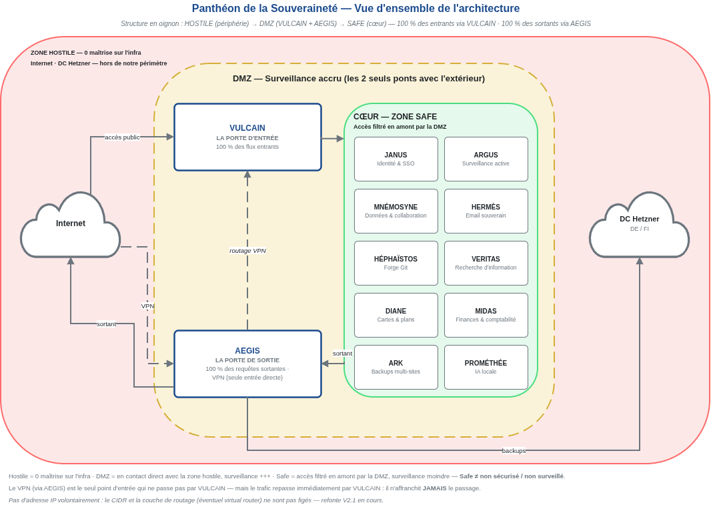

> 🏠 **Développé sur :** [GitLab](https://gitlab.com/schroeder-sys/pantheon-souverainete) · 🪞 **Miroir :** [GitHub](https://github.com/schroeder-sys/pantheon-souverainete) · 🌐 **Site :** [pantheon-souverainete.eu](https://pantheon-souverainete.eu)

---

# 🏛️ Le Panthéon de la Souveraineté

> **Et si vos données vous appartenaient *vraiment* ?**
>
> Pas au sens légal d'un CGU que personne ne lit. Au sens propre : elles ne quittent **jamais** un serveur que **vous** contrôlez. Aucun algorithme ne les scanne. Aucun gouvernement étranger n'y a accès.
>
> **Le Panthéon, c'est ça :** une architecture cloud complète, conçue pour qu'**une personne seule** — vous, moi, n'importe qui — puisse reprendre le contrôle total de sa vie numérique. Pas en bricolant 15 tutoriels obsolètes. Pas en faisant des compromis douteux. En suivant des guides **pensés, testés, documentés** pour que ça marche.
>
> **12 services** (vos propres Gmail, Drive, Maps, etc.). **3 zones de confiance** (HOSTILE, DMZ, SAFE). **2 portes** (VULCAIN entre, AEGIS sort). **Zéro GAFAM** dans la stack.
>
> Bienvenue. 🚀

---

## ⚠️ Disclaimer (parce que l'honnêteté, ça commence tout de suite)

**Je ne suis pas un professionnel *diplômé* de l'IT.** Pas de titre d'ingénieur, pas de certification Cisco/Microsoft, pas de parcours scolaire classique. Juste un auto-entrepreneur IT (Schroeder-Sys) en auto-formation depuis ~5 ans, qui a construit **son** infrastructure pour **ses** besoins, et qui documente le chemin. **Oui, je propose des services IT pro** — [schroeder-sys.fr](https://schroeder-sys.fr) — et **oui, ce projet est sponsorisé par mon auto-entreprise.** C'est compatible.

**Ce projet n'est pas une entreprise.** C'est un travail personnel, fait sur **mon** temps libre, avec **mes** contraintes. Les guides avancent quand j'ai du temps disponible. Si le rythme ne vous correspond pas, je le comprends : **chacun a ses priorités.**

**Ce projet n'est pas parfait.** Il y a des dépendances US structurelles (Docker Hub, Bitwarden) — je les liste, je les cloisonne, je ne les cache pas. Il y a des choix techniques assumés (Debian > Ubuntu, AmneziaWG > WireGuard) — je les explique, je ne les impose pas.

**Ce projet est gratuit.** Si le contenu vous aide ou vous inspire, j'en suis sincèrement content. Si certains choix ne vous correspondent pas, c'est tout aussi respectable. **La souveraineté, c'est un choix personnel — pas une religion.**

---

## 🎯 Le Projet (en vrai, pas en marketing)

### C'est quoi ?

**Une architecture cloud 100% souveraine** — 12 services auto-hébergés organisés en **3 zones de confiance** :

| Zone | Contenu | Exposition |
|------|---------|------------|
| **🌐 HOSTILE** | Internet, DC Hetzner (DE/FI) | 0 maîtrise — tout ce qui est hors de notre périmètre |
| **🟡 DMZ** | VULCAIN (entrée) + AEGIS (sortie + VPN) | Contact direct avec l'hostile — surveillance accrue |
| **🟢 SAFE** | Les 10 autres divinités | Inaccessibles depuis Internet — filtré en amont par la DMZ |

**Règle d'or :** Le VPN (AEGIS) n'affranchit **JAMAIS** le passage par VULCAIN. Même en tunnel, le trafic repasse par la porte d'entrée. **Zero-Trust, pas en slogan — en architecture.**

### Pour qui ?

| Profil | Pourquoi |
|--------|----------|
| **🏠 Particulier engagé** | Vous voulez reprendre le contrôle sans dépendre de tutoriels YouTube obsolètes |
| **🏢 Petite structure / ASSO** | Alternative souveraine, maîtrisée, économiquement viable aux suites cloud propriétaires |
| **🛠️ Passionné·e self-hosted** | Vous aimez comprendre **pourquoi** avant **comment**, et vous valorisez une architecture pensée |
| **🎓 Apprenant·e motivé·e** | Vous êtes prêt·e à investir du temps (réseau, Docker, sécurité) avec des guides exigeants |

**Pré-requis honnêtes :** Bash (débutant), Réseaux (intermédiaire), Docker (intermédiaire), Sécurité (avancé). Si vous débutez complètement, ce projet est **formateur** — mais exigeant.

> **📚 Se former avant de commencer :**
> - **Docker :** [docker.com/trainings](https://www.docker.com/trainings/)
> - **GitLab :** [university.gitlab.com](https://university.gitlab.com/)
> - **GitHub :** [learn.github.com](https://learn.github.com/)

> ### 🚀 Débutant ? Commencez ici
>
> 1. **Lisez le Disclaimer** (2 min) — pour savoir si ce projet est pour vous
> 2. **Explorez l'architecture** (section "Les 12 Divinités") — comprenez le "pourquoi" avant le "comment"
> 3. **Suivez HS-01 (Réseau Privé)** — socle de base (VULCAIN + AEGIS), testable en un week-end *(arrive courant novembre)*
> 4. **Revenez pour le reste** — pas besoin de tout installer d'un coup
>
> 💡 **Astuce :** Des glossaires contextuels sont présents à la fin de chaque section technique. Cliquez sur "📖 Glossaire" pour afficher les définitions.

### Où sont les données ? (Architecture de référence)

- **Principal :** Infomaniak (**Suisse** 🇨🇭) — Public Cloud *(choix du projet, pas une obligation)*
- **Backups :** Hetzner (**Allemagne** 🇩🇪 + **Finlande** 🇫🇮) — Object Storage chiffré
- **Stack :** 100% open source
- **Dépendances US :** Docker Hub, Bitwarden — minimisées et cloisonnées via alias mail

> **Note :** Cette architecture est **reproductible** ailleurs. Vous pouvez héberger chez vous (HomeLab), sur un VPS OVH, ou chez un autre provider européen. Les principes (zones, flux, souveraineté) restent valables — seuls les prestataires changent.

---

## 🤝 Sponsors & Affiliation (transparence totale)

**Financement :**
- **Schroeder-Sys** (mon auto-entreprise IT) — sponsorise le projet (hébergement, temps de dev, tests)
- **Affiliation Infomaniak** — liens **assumés** (voir tableau ci-dessous)
- **Aucune publicité cachée**, aucune levée de fonds
- **Ouvert à d'autres sponsors** — vous avez un produit/service aligné avec la souveraineté européenne ? [Parlons-en](mailto:contact@pantheon-souverainete.eu)

> **Transparence :** Les liens ci-dessous sont des **liens d'affiliation** — même prix pour vous, je touche une commission. Les **300€ de crédit offerts** sont fournis par Infomaniak (à utiliser dans les 3 mois), que vous cliquiez sur mon lien ou non.

### Liens d'affiliation Infomaniak

| Service | Lien | Usage |
|---------|------|-------|
| **🏠 Accueil** | [infomaniak.com/fr/](https://www.infomaniak.com/goto/fr/home?utm_term=6acca8df963ee) | Page d'accueil générale |
| **☁️ Public Cloud** | [infomaniak.com/fr/hebergement/public-cloud](https://www.infomaniak.com/fr/hebergement/public-cloud?utm_term=6acca8df963ee) | **300€ offerts sur 3 mois** — idéal pour tester |
| **🖥️ VPS Cloud** | [infomaniak.com/fr/hebergement/vps-cloud](https://www.infomaniak.com/fr/hebergement/vps-cloud?utm_term=6acca8df963ee) | VPS classiques |
| **💚 VPS Lite** | [infomaniak.com/fr/hebergement/vps-lite](https://www.infomaniak.com/fr/hebergement/vps-lite?utm_term=6acca8df963ee) | VPS entrée de gamme |
| **💾 NAS Synology** | [infomaniak.com/goto/fr/hosting.synology](https://www.infomaniak.com/goto/fr/hosting.synology?utm_term=6acca8df963ee) | NAS hébergés |
| **📦 myKsuite+** | [infomaniak.com/fr/ksuite/myksuite](https://www.infomaniak.com/fr/ksuite/myksuite?utm_term=6acca8df963ee) | Suite collaborative (Euria) |
| **🤖 AI Tools** | [infomaniak.com/fr/hebergement/llm-api](https://www.infomaniak.com/fr/hebergement/llm-api?utm_term=6acca8df963ee) | API IA (Qwen, Kimi, etc.) |

**Recommandation (sans affiliation) :**
- **SimpleLogin** ([simplelogin.io](https://simplelogin.io)) — 🇫🇷 Français (ProtonAG 🇨🇭), gratuit, open source. Jamais testé personnellement.

---

## 🏛️ Les 12 Divinités

### Philosophie des Forks

**Règle :** Un fork n'est justifié que s'il apporte un **gain significatif en sécurité ou confidentialité**. Sinon, on reste sur la source.

| Choix | Pourquoi |
|-------|----------|
| **Debian > Ubuntu** | Debian est la source. On ne peut pas attendre un patch sur le système lui-même (sécurité & stabilité). |
| **AmneziaWG > WireGuard** | Fork assumé : gain significatif en confidentialité (obfuscation anti-DPI). Ils travaillent avec WireGuard. |
| **Bitwarden > Vaultwarden** | Bitwarden est la source. Vaultwarden lui-même indique des fenêtres d'incompatibilité. |

> 

> 
📖 <b>Glossaire de cette section</b> (cliquez pour afficher)

> 
> - **Fork** : Copie d'un projet open source modifiée indépendamment. Ici, on ne fork que si ça améliore la sécurité/confidentialité.
> - **Obfuscation anti-DPI** : Technique pour masquer le trafic VPN afin qu'il ne soit pas détecté/bloqué par les FAI ou gouvernements (DPI = Deep Packet Inspection).
> 
> 

### Choix Techniques

**Triptyque de décision :** Sécurité · Compatibilité · Simplicité

- **wg-easy** (vs WireGuard brut) — Simplicité d'usage, configuration web.
- **GateKeeper** (vs Altcha) — Compatible avec CrowdSec, documenté, intégré nativement.

> 

> 
📖 <b>Glossaire de cette section</b> (cliquez pour afficher)

> 
> - **wg-easy** : Interface web simple pour gérer WireGuard. Plus accessible que la ligne de commande.
> 
> 

### Tiers de Confiance & Dépendances

| Tiers | Rôle | Données | Localisation | Statut |
|-------|------|---------|--------------|--------|
| **CrowdSec** | Sécurité collaborative | IPs malveillantes (anonymisées) | 🇫🇷 France | ✅ Confiance |
| **Actalis** | Certificats SSL | Email de contact | 🇮🇹 Italie | ✅ Confiance |
| **Certum** | Certificats S/MIME | Identité + Email | 🇵🇱 Pologne | ✅ Confiance |
| **Infomaniak** | Hébergement principal | Données + facturation | 🇨🇭 Suisse | ✅ Confiance |
| **Hetzner** | Backups multi-DC | Données chiffrées | 🇩🇪🇫🇮 Allemagne/Finlande | ✅ Confiance |
| **Docker Hub** | Registry d'images | Email (compte gratuit) | 🇺🇸 USA | ⚠️ Dépendance structurelle |
| **Bitwarden** | Mots de passe | Email (clé de licence self-host) | 🇺🇸 USA | ⚠️ Dépendance structurelle |

> **Philosophie :** Les dépendances US (Docker Hub, Bitwarden) sont **structurelles et inhérentes**. Les alias mail ne les suppriment pas, ils les **isolent**.

> 

> 
📖 <b>Glossaire de cette section</b> (cliquez pour afficher)

> 
> - **Données anonymisées** : Informations dont les identifiants personnels ont été retirés. CrowdSec reçoit des IPs d'attaquants, pas votre identité.
> - **S/MIME** : Standard de chiffrement et signature des emails. Certum fournit les certificats pour prouver votre identité.
> - **Registry** : Bibliothèque d'images Docker. Docker Hub est le "Google Play" des conteneurs.
> - **Dépendance structurelle** : Dépendance impossible à supprimer sans tout réécrire. On l'isole, on ne la nie pas.
> 
> 

> **Comment lire le schéma :** 🌐 **HOSTILE** = 0 maîtrise (Internet, DC Hetzner) · 🟡 **DMZ** = les 2 seuls ponts avec l'extérieur, surveillance accrue — **VULCAIN** (100 % des flux entrants) + **AEGIS** (100 % des requêtes sortantes + VPN) · 🟢 **SAFE** (cœur) = les 10 divinités métier, accès filtré en amont. **Le VPN n'affranchit JAMAIS le passage par VULCAIN.**
>
> 🔍 **Zooms :** [Topologie globale (SVG)](docs/99_COMMUN/schemas/topologie-globale.svg) · [Cas types de circulation (SVG)](docs/99_COMMUN/schemas/exemples-circulation.svg)

### Socle (4 divinités — indispensables)

| Divinité | Rôle | Stack | Statut V2.2 |
|----------|------|-------|-------------|
| **VULCAIN** | Porte d'entrée — reverse proxy & WAF | Traefik + CrowdSec + GateKeeper + **Pangolin (mTLS via WireGuard) à l'étude** | 🚧 En cours |
| **AEGIS** | Porte de sortie — DNS souverain & VPN | WireGuard + AdGuard + Unbound + **AmneziaWG (obfuscation anti-DPI)** | 🚧 En cours |
| **ARGUS** | Surveillance active | Grafana + Prometheus + Node Exporter | ⚪ Vierge |
| **ARK** | Coffre-fort multi-sites | Restic + **BorgBackup (à l'étude)** | 🔁 En révision |

> 

> 
📖 <b>Glossaire de cette section</b> (cliquez pour afficher)

> 
> - **Reverse Proxy** : Serveur qui reçoit toutes les requêtes entrantes et les redistribue aux bons services. Une seule porte, pas 12.
> - **WAF** : Web Application Firewall — filtre les attaques web (injections, XSS, etc.) avant qu'elles n'atteignent vos services.
> - **mTLS** : Mutual TLS — authentification par certificats dans les deux sens (client ET serveur). Plus sécurisé qu'un mot de passe.
> - **DNS souverain** : Vous gérez vos propres résolutions de noms, sans passer par Google/Cloudflare. Vos requêtes DNS ne sortent pas.
> - **Surveillance active** : Collecte de métriques en temps réel (CPU, RAM, réseau) pour détecter les anomalies avant la panne.
> 
> 

### Métier (8 divinités — services finals)

| Divinité | Rôle | Stack | Statut V2.2 |
|----------|------|-------|-------------|
| **JANUS** | Identité & SSO | Bitwarden + Authentik | 🔁 En révision (Authentik audité) |
| **MNÉMOSYNE** | Données & collaboration | NextCloud + **Suite bureautique en ligne (à définir)** | 🔁 En révision |
| **HERMÈS** | Email souverain | Postfix + Dovecot + **SimpleLogin (recommandation)** | ⚪ Vierge |
| **HÉPHAÏSTOS** | Forge interne | Forgejo (Git self-hosted) | ⚪ Vierge |
| **VERITAS** | Recherche d'information | SearXNG | ⚪ Vierge |
| **DIANE** | Cartes & plans | **Valhalla + OSM** | ⚪ Vierge |
| **MIDAS** | Finances & comptabilité | — | ⚪ Vierge |
| **PROMÉTHÉE** | IA locale | **Ollama + Mixtral** | ⚪ Vierge |

> 

> 
📖 <b>Glossaire de cette section</b> (cliquez pour afficher)

> 
> - **SSO** : Single Sign-On — un seul mot de passe pour accéder à tous vos services (via Authentik).
> - **Suite bureautique en ligne** : Équivalent de Google Docs/Sheets, mais auto-hébergé (Collabora, OnlyOffice, etc.).
> - **Git self-hosted** : Version auto-hébergée de GitHub/GitLab. Vous gardez le contrôle total de votre code.
> - **OSM** : OpenStreetMap — cartes libres et gratuites, équivalent open source de Google Maps.
> 
> 

> **🤡 Note auteur :** J'étais tellement concentré sur la philosophie des forks, l'architecture V2.2 et les recherches pour améliorer le projet... que j'en ai oublié les bases : mentionner les tiers de confiance. Comme d'habitude, quoi.

---

## 📅 Roadmap

### En bref (pour les pressés)

| Étape | Contenu | Temps |
|-------|---------|-------|
| **🚀 Socle** | VULCAIN + AEGIS — les 2 portes | ~20h |
| **🔒 Renfort** | + ARGUS (monitoring) + ARK (backups) | ~40h |
| **🏛️ Les 8 autres** | À votre rythme, selon vos besoins | ~600h |

### Cycle de version (SemVer)

> **⚠️ Important :** Les volumes horaires ci-dessus concernent **la création des guides** (mon temps de dev/test/rédaction), **PAS votre temps de déploiement**. Une fois les guides publiés, déployer les 12 divinités prend **moins d'une semaine** (tests inclus) en suivant les étapes.

| Phase | Période | Version | Durée | Heures (création) | Statut |
|-------|---------|---------|-------|-------------------|--------|
| **Phase 1** | Q4 2026 | `2.2.0-alpha` | 3 mois | 80-100h | 🚧 En cours |
| **Phase 2** | Q1 2027 | `2.2.0-alpha` | 3 mois | 120-150h | ⏳ À venir |
| **Phase 3** | Q2 2027 | `2.2.0-alpha` | 3 mois | 100-120h | ⏳ À venir |
| **Phase 4** | Q3 2027 | `2.2.0-alpha` | 3 mois | 100-120h | ⏳ À venir |
| **Phase 5** | Q4 2027 | `2.2.0-beta` | 3 mois | 80-100h | ⏳ À venir |
| **Phase 6** | Q1 2028 | `2.2.0` ✅ | 3 mois | 60-80h | ⏳ À venir |
| **Phase 7** | Q2 2028 | `2.2.0` | 3 mois | 40-60h | ⏳ À venir |
| **Phase 8** | Q3 2028+ | `2.x.0`+ | Variable | Variable | ⏳ À venir |

**Jalons :**
- **Fin Alpha** (Phase 4) → Tous les guides publiés + testés indépendamment
- **Fin Bêta** (Phase 5) → Structure complète testée + guides mis à jour
- **Stable** (Phase 6) → Retours communauté intégrés + aucun bug critique

> **⚠️ Important :** Je ne promets **jamais** de dates chiffrées. Un "96h" a déjà dérapé de 2 mois pour raisons perso. Les phases sont des objectifs, pas des engagements.

---

## 🎯 Conclusion (parce qu'il faut bien finir)

**La souveraineté numérique n'est pas un luxe, c'est un choix.** Et ce choix devrait être accessible — pas réservé à une élite technique ou à des budgets enterprise.

**Le Panthéon, c'est ma réponse** à ce constat. Une architecture **réelle**, documentée **honnêtement**, partagée **gratuitement**. Pas de dates promises. Pas de "ça marche du premier coup" magique. Pas de dépendances cachées.

**Ce projet est le mien.** C'est **mon** infrastructure, construite sur **mon** temps libre, pour **mes** besoins. Je la documente et je la partage parce que j'espère que ça aidera d'autres personnes dans leur démarche.

Si le contenu vous aide ou vous inspire, j'en suis sincèrement content. Si le rythme ou certains choix ne vous correspondent pas, je le comprends tout à fait : **chacun a ses contraintes, ses priorités, sa propre vision.**

---

## 🤝 Contribuer (parce que ce projet est aussi le vôtre)

**Ce README est vivant.** Si vous trouvez une erreur, une coquille, une incohérence — ouvrez une **Issue** sur GitLab ou GitHub. Je fais de mon mieux pour répondre.

**Si vous voulez aller plus loin :**
- **Proposez une PR** — Une amélioration, un guide complémentaire, un schéma zoom ? Je suis preneur.
- **Partagez votre expérience** — Vous avez déployé le Panthéon ? Vous avez buté sur un point ? Votre retour aide la communauté.
- **Contactez-moi** — [contact@pantheon-souverainete.eu](mailto:contact@pantheon-souverainete.eu) — Je réponds quand je peux, mais je réponds. Promis.

> **🆕 Nouveau sur GitLab/GitHub ?**
> - **GitLab :** [university.gitlab.com](https://university.gitlab.com/) — Issues, Merge Requests, etc.
> - **GitHub :** [learn.github.com](https://learn.github.com/) — Issues, Pull Requests, etc.

**Besoin d'un accompagnement pro ?**
- **Site pro :** [schroeder-sys.fr](https://schroeder-sys.fr) — Audit, intégration, accompagnement (si vous voulez aller plus loin avec un humain)
- **Email pro :** [contact@schroeder-sys.fr](mailto:contact@schroeder-sys.fr) — Devis, audit, intégration

---

> **🚀 Vous êtes arrivé·e au bout.**
>
> Si ce README vous a donné envie d'aller plus loin, c'est que vous avez compris l'essentiel. **La souveraineté, c'est un choix — et ce choix, vous pouvez le faire aujourd'hui.**
>
> **Par où commencer ?**
> 1.  **Disclaimer** — Sachez où vous mettez les pieds (2 min)
> 2.  **Architecture** (section "Les 12 Divinités") — Comprenez le "pourquoi" avant le "comment"
> 3.  **Guides** (Hors-Séries) — HS-01 (Réseau Privé) arrive courant novembre
> 4.  **Contribuez** — Une erreur ? Une amélioration ? Ce projet est le vôtre autant que le mien
>
> **Merci d'avoir lu.** Et surtout : **bonne construction.** 🏛️
>
> — Christopher Schroëder
>
> **Dernière mise à jour :** 28 octobre 2026  
> **Version :** 2.2.0-alpha  
> **Auteur :** Christopher Schroëder (Schroeder-Sys / Greencode Solutions)  
> **Assistance IA :** Euria (myKsuite+), Qwen3.5 & Qwen3.8, Kimi-K2.6 (AI Tools Infomaniak)
